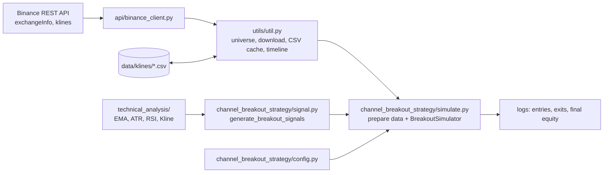

# CTB: Crypto Trading Bot (channel-breakout backtester)

CTB is a lightweight Python backtester. It replays a volatility-adjusted channel-breakout strategy across Binance USDC spot pairs as one multi-asset portfolio. The simulation covers risk-based position sizing, ATR filters and trailing stops.

> **Disclaimer:** This is a personal research and learning project, not financial advice. No profitability is claimed or implied. If you use it, you do so at your own risk. The simulator only reads public market data. If you extend it to place orders, start on the Binance Spot Testnet, and never put keys for a funded account in the code or config.

## Features

- **Symbol universe.** Uses every Binance spot pair that is currently `TRADING` and quoted in USDC. The list is sorted and capped at a configurable limit.
- **Historical data with caching.** Downloads klines in pages of 1000 with a polite pause between requests. Each symbol is cached to `data/klines/{SYMBOL}_{interval}.csv`, so you can iterate offline without hitting the API again.
- **Indicators written from scratch.** EMA (seeded with an SMA), ATR (Wilder) and RSI (Wilder) are plain Python, with no pandas or NumPy.
- **Pure signal engine.** `generate_breakout_signals()` is a side-effect-free function, so it can be reused by other simulators or a future live trader.
- **Portfolio simulator.** Walks one 4h timeline across all symbols. It sizes each trade so that a fixed fraction of equity is at risk, respects available cash, a minimum trade size and a cap on concurrent positions, and handles stop-loss, take-profit, a trailing stop and a maximum holding period.
- **Structured logging.** Every entry and exit is logged, followed by final equity, realized PnL and cash.
- **Binance REST client.** Public market-data calls plus HMAC-SHA256 signed endpoints: market and limit orders, order status, cancel, and account balance. The signed endpoints are groundwork for live trading and are not used by the simulator yet.

## Strategy

The strategy is long-only and runs on 4h candles. The defaults below come from `channel_breakout_strategy/config.py`.

**Entry signal** (`channel_breakout_strategy/signal.py`):

1. **Trend regime:** EMA(21) is above EMA(100).
2. **Volatility filter:** ATR(14) / close is at least 0.2%.
3. **Breakout trigger:** the close is above the highest high of the previous 20 candles plus 0.10 × ATR. The signal fires once per breakout and re-arms only after price drops back below the threshold or a filter fails.
4. **Initial stop:** the lowest low of the previous 20 candles minus 2.0 × ATR. If the stop is not below the price, the signal is discarded.
5. **Take profit:** entry + 3.0 × (entry − stop), a 3R target.

**Position management** (`channel_breakout_strategy/simulate.py`):

- **Entry price:** the close of the signal candle.
- **Size:** `qty = (equity × 1%) / (entry − stop)`. If that costs more than the available cash, the position is reduced to fit. Trades under $10 are skipped.
- **Position cap:** at most 4 open positions. At each timestamp, new entries are evaluated first, then all open positions are managed.
- **Exit order:** the stop-loss is checked first (`low <= stop`), then the take-profit (`high >= tp`).
- **Trailing stop:** activates once the unrealized gain reaches 1.5R. After that the stop ratchets up to `max(stop, entry + 0.75R, close − 1.5R)`, where R is the initial risk per unit.
- **Time exit:** the position is closed at market after 400 candles.

## Architecture



1. Load the klines, either from the CSV cache or from Binance (in which case they are optionally written to the cache).
2. Convert each symbol's rows into `Kline` objects and precompute all breakout signals for that symbol.
3. Build a 4h timeline that covers the requested window, or the date range of the cache when loading from CSV, then step through it. At each timestamp, open new positions on fresh signals, then update the stops and exits of open positions.
4. Return a `SimulationResult` with final equity, cash, realized PnL and the number of positions still open.

## Tech stack

- Python 3.10+ (uses `dataclass(slots=True)`)
- [`requests`](https://pypi.org/project/requests/) for the Binance REST API (spot v3)
- Standard library: `dataclasses`, `logging`, `csv`, `hmac`/`hashlib`, `smtplib`

## Repository layout

```
ctb/
├── api/
│   └── binance_client.py        # REST client: symbols, klines (paginated), price, signed order/account endpoints
├── channel_breakout_strategy/
│   ├── config.py                # Config dataclass: data, strategy, risk and cache settings
│   ├── signal.py                # Pure breakout signal generator
│   ├── models.py                # SymbolData, Position, SimulationResult dataclasses
│   └── simulate.py              # Data preparation, BreakoutSimulator, CLI entry point
├── technical_analysis/
│   ├── indicators.py            # EMA, ATR, RSI
│   └── kline.py                 # Typed Kline built from raw Binance rows
├── utils/
│   └── util.py                  # Universe, kline download / CSV cache, timeline helpers
├── notification/
│   └── email_notifier.py        # SMTP email helper (not wired in yet)
└── requirements.txt
```

## Getting started

```bash
git clone https://github.com/karimimh/ctb.git
cd ctb
python3 -m venv .venv
source .venv/bin/activate
pip install -r requirements.txt
```

The simulator uses public endpoints only, so it needs no API keys and no `.env`.

## Usage

Run from the repository root, because the packages import each other by absolute name (for example `from api.binance_client import ...`):

```bash
python -m channel_breakout_strategy.simulate
```

**First run.** By default `load_klines_from_csv = True`, so the simulator reads from `data/klines/`. On a fresh clone that folder is empty, and the run stops with `No kline CSV files found in data/klines for interval 4h`. To download data:

1. In `channel_breakout_strategy/config.py`, set `load_klines_from_csv = False`.
2. Run the command above. It downloads `default_days` (365) of 4h candles for up to `default_symbols_limit` (80) USDC pairs. Because `save_downloaded_klines = True`, it also writes them to `data/klines/`.
3. Set `load_klines_from_csv` back to `True` and re-run as often as you like against the cache. The cache is git-ignored. In cache mode the backtest window is the date range of the cached files, and `default_days` is ignored.

**Output.** Log lines in this format (placeholders shown):

```
<ts> INFO <candle time> ENTER <SYMBOL> qty <q> @ <entry> stop <stop> tp <tp> risk <R>
<ts> INFO <candle time> EXIT <SYMBOL> @ <price> (stop-loss|take-profit|max-hold) pnl <pnl>
<ts> INFO Breakout Simulation complete: equity <equity> cash <cash> realized <pnl>
<ts> INFO Breakout Final equity: <equity> | Realized PnL: <pnl> | Cash: <cash>
```

## Configuration

All settings are dataclass defaults in [`channel_breakout_strategy/config.py`](channel_breakout_strategy/config.py). `Config.load()` returns those defaults and does not read environment variables or CLI flags, so to change a setting you edit that file.

| Group | Setting | Default |
|-------|---------|---------|
| Data | `timeframe` / `timeframe_hours` | `"4h"` / `4` |
| | `default_days` | `365` |
| | `default_symbols_limit` | `80` |
| Signal | `fast_ema_period` / `slow_ema_period` | `21` / `100` |
| | `atr_period` | `14` |
| | `channel_lookback` | `20` |
| | `entry_atr_buffer` | `0.10` |
| | `stop_atr_mult` | `2.0` |
| | `reward_risk` | `3.0` |
| | `min_atr_pct` | `0.002` |
| Risk | `initial_capital` | `1000.0` |
| | `risk_per_trade_pct` | `0.01` |
| | `min_trade_allocation` | `10.0` |
| | `max_open_positions` | `4` |
| Trade management | `trail_activate_rr` / `trail_lock_rr` / `trail_atr_mult` | `1.5` / `0.75` / `1.5` |
| | `max_hold_candles` | `400` |
| Cache | `kline_csv_dir` | `"data/klines"` |
| | `save_downloaded_klines` | `True` |
| | `load_klines_from_csv` | `True` |

`binance_api_key`, `binance_api_secret` and `sandbox` are placeholders for future live trading. The simulator does not need them.

## Testing

There is no automated test suite yet. The indicator and signal functions are pure, which makes them straightforward to unit test, and adding tests is next on the roadmap.

## Project status

CTB is at the research and backtesting stage. Live order execution is **not** implemented. Known limitations:

- **Simplified fills and costs.** No trading fees or slippage are modelled. Entries fill at the signal candle's close.
- **Trailing stop.** It uses the initial risk (R) as its volatility unit, not a live ATR value.
- **Testnet flag.** The `sandbox` flag is not wired up: `BinanceClient` always targets `https://api.binance.com`.
- **No CLI or environment configuration yet.** Settings are changed by editing `config.py`.
- **Unused code.** `notification/email_notifier.py` and the signed order and account methods in `api/binance_client.py` are present but not used yet.

## Roadmap

- CLI flags and environment-based configuration
- Fees and slippage, plus a performance report (trade log export, win rate, drawdown)
- Unit tests for indicators, signals and the simulator, and CI
- Paper trading against the Binance Spot Testnet using the existing signed client
- Email alerts on entries and exits
